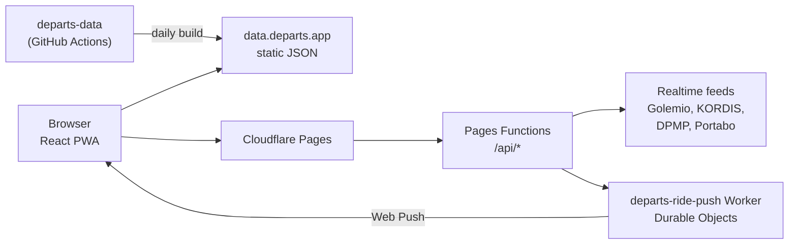

# Overview

departs.app is a real-time public transport app for Czech and Slovak cities. It shows live departures and vehicles on a map and installs as a PWA.

**Live:** [departs.app](https://departs.app) · **Source:** [GitHub](https://github.com/Joseph5610/departs-app) · **License:** MIT

## Networks

| Network | Region | Status |
| ------- | ------ | ------ |
| PID | Prague and Central Bohemia | Live |
| IDS JMK | Brno and South Moravia | Live |
| DPMP | Prešov city transport | Live |
| DÚK | Ústí nad Labem region | In development |

## Features

- **Departure boards** with live delays, platforms, connections and a full-screen board mode.
- **Live map** of every vehicle, with its delay, route shape and stop timeline.
- **Ride mode**: pick the stop where you get off and get a notification one stop before it, even with the screen locked.
- **Favourites, search and nearby stops**, with walking distance to each stop.
- **Installable PWA** on iOS, Android and desktop, in Czech, Slovak and English.
- **Remote MCP server**, so AI assistants can query departures, vehicles and service alerts.

## How it fits together

- **Static data** (stops, routes, shapes, timetables) is built daily by the [departs-data](https://github.com/Joseph5610/departs-data) repository and served from `data.departs.app`.
- **The app** is a Vite + React 19 PWA on Cloudflare Pages. Its **Pages Functions** fetch, normalise and cache each network's realtime feed.
- **Ride notifications** come from a separate Worker with a Durable Object per trip; see [Ride notifications](./ride-notifications.md).

Everything runs on free plans: Cloudflare for the app, GitHub Pages for the data.

## Stack

| Area | Technology |
| ---- | ---------- |
| Frontend | React 19, TypeScript, Vite, Tailwind CSS 4, shadcn/ui (Base UI), Zustand, TanStack Query |
| Map | MapLibre GL JS, react-map-gl |
| Backend | Cloudflare Pages Functions, Workers, Durable Objects, KV |
| Tests | Vitest (unit), Playwright (end-to-end) |
| Docs | VitePress |

## Guides

- [Local development](./local-development.md): run the app on your machine.
- [Production deployment](./deployment.md): set up the app on Cloudflare, step by step.
- [Ride push deployment](./ride-push-deployment.md): add Web Push for ride mode.
- [Ride notifications](./ride-notifications.md): how ride-mode push works inside.
- [Remote MCP server](./mcp-server.md): connect AI assistants to live transit data.
- [Data sources and licences](./data-sources.md): where the data comes from and on what terms.
