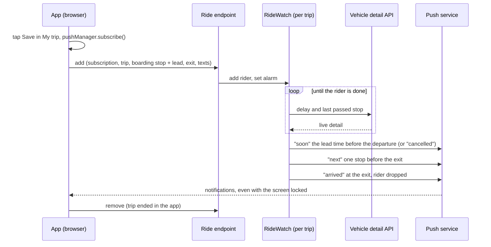

# Push notifications

The app sends two kinds of Web Push, both from the `departs-ride-push` Worker:

- **My trips**: the trip a rider takes. It reminds them before the trip leaves their stop (or says it was cancelled), tells them to get off one stop before their exit, and again on arrival.
- **Disruptions**: a new disruption on a line the user pinned ([below](#disruption-notifications)).

While the app is open, a trip alerts by itself too. With the screen locked the app is suspended, so only pushes from the server get through. [Ride push deployment](./ride-push-deployment.md) covers setting this up.

## Shared parts

| Piece | Where | Role |
| ----- | ----- | ---- |
| Subscription | `src/lib/push.ts` | One push subscription per device for both kinds. `preparePush` (from `usePWALifecycle`) finds the push manager early, so the tap subscribes before any `await`: Safari asks for permission only from the tap itself |
| Push sender | `functions/_core/push/webPush.ts` | VAPID signing (RFC 8292), payload encryption (RFC 8291) and the Declarative Web Push message (`declarativePush`) with WebCrypto only; `isDeviceKey` refuses a subscription whose key isn't a P-256 point |
| Request checks | `functions/_core/rideSchemas.ts`, `functions/_core/apiUtils.ts` (`readJsonBody`, `forwardToWatch`) | Body size limit, push endpoint on a known push service, key format; hands the validated command to the Durable Object |
| Worker | `functions/_workers/ridePush.ts` | Hosts `RideWatch` and `DisruptionWatch`; no public address, reached only through Pages bindings |
| Service worker | `public/push-sw.js`, imported into the app's service worker | Shows the notification in browsers without Declarative Web Push, sets the icon badge, opens `navigate` on a tap |

## My trips

| Piece | Where | Role |
| ----- | ----- | ---- |
| Save and register | `src/hooks/features/useMyTripActions.ts`, from `MyTripSheet.tsx` | Saves the trip (boarding stop, lead time, exit) and, on the same tap, registers it with the API with the alert texts in the user's language |
| Withdraw | `src/hooks/features/useRidePush.ts` | When a trip ends or no longer has anything to push, withdraws it; a withdrawal that failed (offline) is retried at the next start and when back online, for up to a day |
| Endpoint | `functions/api/[city]/ride.ts` | Validates the request and forwards it to the trip's Durable Object |
| `RideWatch` Durable Object | `functions/_workers/RideWatch.ts`, logic in `functions/_domain/rides/watchRun.ts` | Holds the trip's riders, wakes on an alarm, reads the trip's live detail, sends the pushes |
| Rules | `functions/_domain/rides/tripWatch.ts`, `departureAlert.ts`, `rideAlert.ts`, `shared/rides.ts` | Rider phases, when the boarding reminder is due, when the vehicle left a stop |

### Flow



Each rider moves forward through phases: `remind` (waiting to send the boarding reminder), `board` (waiting for the vehicle to leave the boarding stop), `ride` (watching the exit), `near` (`next` sent), `done`.

1. **Register.** Saving a trip sends the subscription, the boarding stop's sequence with its timetable departure and lead time, the exit's sequence (none when riding to the end), the trip's page and the texts. A save that changes what is pushed registers afresh and replaces the earlier registration. If that fails, the earlier one is withdrawn and the app alerts only while open.
2. **Boarding reminder.** Checks start 10 minutes before the reminder is due, then halve the time left, at most every 30 s. The reminder (`soon`, with the minutes left) goes when the predicted departure (timetable plus live delay) minus the lead is within 30 s. `cancelled` goes instead if the feed reports the trip cancelled. If the vehicle has already left the stop, the reminder is dropped unsent.
3. **Exit watch.** Once boarded, the alarm wakes every 15 s while the rider is within two stops of the exit and every 90 s otherwise. `next` goes once the vehicle has passed the stop before the exit. `arrived` goes at the exit or the trip's last stop, even if `next` was missed. After `arrived` the rider is dropped.
4. **End.** Ending a trip in the app removes the rider. With no riders left the Durable Object deletes its storage and stops waking.

The vehicle's position is the feed's last passed stop, so every city works the same way, including Brno, whose server-side feed reports positions without delays. A trip with no live position yet is watched without alerting until the vehicle shows up.

### Message format

Pushes use **Declarative Web Push** (`web_push: 8030`). Safari on iOS and macOS 18.4+ shows these without running the service worker, which makes them more reliable. Other browsers hand the same JSON to `push-sw.js`, which shows it the same way.

```json
{
  "web_push": 8030,
  "notification": {
    "title": "Get off at the next stop",
    "body": "Trutnovská",
    "navigate": "https://departs.app/prague/trip/58_1865_250714/service-0-8518",
    "tag": "ride-own:58_1865_250714",
    "requireInteraction": true,
    "renotify": true,
    "vibrate": [300, 150, 300, 150, 600]
  }
}
```

- **`navigate`**: the trip's page, on the origin the rider registered from.
- **`tag`**: per trip, one for the boarding alerts and one for the exit alerts, so `arrived` replaces `next` and two trips never replace each other.
- **`requireInteraction`, `renotify`, `vibrate`**: per alert in `RIDE_PUSH.ALERT_OPTIONS`; Android and desktop Chrome honour them, iOS ignores them. On Android the service worker also sets the monochrome status-bar badge `public/notification-badge.png`.

While the app is open the push still arrives as a system notification, and the app adds only a toast and a vibration (`alertRider` with `pushed`).

### Limits and safeguards

All tunables live in `RIDE_PUSH` in `functions/_core/config.ts`.

| Safeguard | Value |
| --------- | ----- |
| Push endpoint must be `https` on a known push service | `PUSH_SERVICE_HOSTS` |
| Subscription key must be a P-256 point, auth a 16-byte secret | `rideSchemas.ts`, `isDeviceKey` |
| Request body | 8 KB |
| Boarding departure | not in the past by more than 4 h, nor beyond what the timetable comparison covers |
| Riders per trip | 50 |
| Rider lifetime | 4 h from the departure (or from registering, when already aboard) |
| Trip id that never answered (made up) | given up after 2 reads |
| Detail reads failing | retried with backoff from 30 s up to 5 min, the trip given up after 1 h |
| Vehicle without a live position after it had one | given up after 10 min |
| Push refused for a while (429, 5xx, no answer) | retried 5 times, then that alert is given up |
| Subscription the push service no longer knows (404, 410) | dropped |

### Costs on the free plan

- **Durable Objects**: their own 100,000 requests a day. A trip takes roughly 15–30 alarms.
- **Workers and Pages Functions**: one shared 100,000 requests a day. Each alarm reads `/api/<city>/vehicle-detail` once.
- **CPU**: an alarm takes 1–2 ms, the detail read 3–8 ms, both well under the 10 ms limit.

## Disruption notifications

The same Worker pushes new disruptions on the lines a device pinned, once the user turns it on.

| Piece | Where | Role |
| ----- | ----- | ---- |
| Switch | `src/components/Alerts/DisruptionPushToggle.tsx` | The same switch in Settings and in the alerts view |
| What counts as a disruption | `shared/alerts.ts` (`alertPhase`) | An incident that has started and not ended; one without an end that started over 7 days ago is stale. The alerts badge, the home sheet and the pushes all use it |
| Line keys | `src/domain/alerts/pushKeys.ts` | Each pinned line with the route ids, name and KORDIS numeric id its alerts may name it by, so the Worker needs no routes table |
| Sync plan | `src/domain/alerts/pushSync.ts` | Works out which cities need an add or a removal |
| Sync and badge | `src/hooks/features/useDisruptionPush.ts` | Carries the plan out one step at a time and sets the app icon badge; runs in `DisruptionPushSync`, which reads nothing while the feature is off |
| Endpoint | `functions/api/[city]/disruptions.ts` | Validates (`functions/_core/disruptionSchemas.ts`) and forwards to the city's Durable Object |
| `DisruptionWatch` Durable Object | `functions/_workers/DisruptionWatch.ts`, logic in `functions/_domain/disruptions/watchRun.ts` | Polls the city's alerts as often as `/alerts` caches them (5 min), pushes each newly current incident to the subscribers whose lines it names; what doesn't fit one alarm's 40 subrequests (the free plan allows 50) goes out from the next alarm a second later, which picks up after the last subscriber reached |

1. **Turn on.** The Settings switch, or the same switch in the alerts view while it is off, subscribes from the tap and registers the city's pinned lines. It shows only in cities with an alerts feed (Prague, Brno).
2. **Keep in step.** While on, `useDisruptionPush` covers every city with pinned lines, not only the selected one. It sends a city's lines again when the pins, the language or the subscription change (3 s after the last change), and on any return to the app once a week, renewing the server's 60-day expiry. Unpinning a city's last line removes the city. Sync work runs one task at a time, and a city's requests go out in order (`inOrder` in `src/lib/push.ts`), so quick changes can't overtake each other.
3. **Lost subscription.** If the browser dropped the subscription while permission stands, the app subscribes again by itself. If permission is gone, it turns the switch off and says so: a switch that reads on must mean pushes can arrive.
4. **Turn off.** The switch only records it; `useDisruptionPushOff` withdraws every city the server still holds, retrying a failure when back online and at the next start. A registration still on its way when the switch went off is withdrawn as soon as it lands.

A poll that finds nothing new writes nothing to storage, and the full subscriber list is read only for a new incident or the daily sweep of lapsed subscriptions, to stay within the free plan's row limits. The first read after the watch starts only records what is already running, and an upcoming incident is pushed when it starts. Each push carries `app_badge`, the count of current incidents on the subscriber's lines in that city; the app writes the selected city's count at every alerts read and on every return to it, since an ended incident cannot be pushed away. With pins in two cities the icon therefore shows one city's count, not their sum.

### Message format

```json
{
  "web_push": 8030,
  "notification": {
    "title": "Disruption · 9, 22",
    "body": "Accident at Anděl, trams diverted",
    "navigate": "https://departs.app/prague?alert=<alert guid>",
    "tag": "disruption:<alert guid>"
  },
  "app_badge": 2
}
```

The title is the user's translated template with `{lines}` (`DISRUPTION_PROTOCOL.LINES_TOKEN`) replaced by the matched pinned lines. A tap opens the alert itself: `navigate` carries `?alert=<guid>` (`DISRUPTION_PROTOCOL.ALERT_PARAM`), which `useAlertDeepLink` turns into the expanded alert. An alert without a guid opens the city, whose home sheet lists the disruptions on the pinned lines.

### Limits and safeguards

All tunables live in `DISRUPTION_PUSH` in `functions/_core/config.ts` and `DISRUPTION_PROTOCOL` in `shared/alerts.ts`.

| Safeguard | Value |
| --------- | ----- |
| Endpoint, keys and body checks | as for My trips, body up to 16 KB |
| Pinned lines per subscription | 80, each with up to 8 keys |
| Notification page | a city path only (`/prague`), resolved on the origin that registered |
| New subscriptions per address | 20 per city per day (429 beyond that), counting IPv6 by its /64; renewals don't count. The address is never stored, only a hash under a salt drawn per day, swept the next day |
| Subscribers per city | 5,000, counted in storage; a full city drops its newest subscription, so a flood only churns itself and devices that renew stay |
| Pushes per subscriber | 3 per alerts read; more incidents at once only show in the badge |
| Subscription lifetime | 60 days without renewal; lapsed ones are skipped at once and swept daily |
| Subscription the push service no longer knows (404, 410) | dropped |
| VAPID keys missing | the watch runs on without sending: subscribers survive a bad deploy and lapsed ones are still swept, but incidents that start meanwhile are not pushed later |

Anyone can call the endpoint, as with My trips, but a subscription only reaches the device that owns it: its endpoint is unguessable and the push is encrypted for its keys. Removing a subscription needs its endpoint. The daily quota is what stops one address filling a city; the zone's rate limit on `/api/*` is too generous for that ([Production deployment, step 7](./deployment.md#rate-limiting-security--security-rules)). A flood from many addresses can still spend the free plan's daily requests, like one against any other endpoint.

### Costs on the free plan

Each city with subscribers costs 288 alarms and 288 `/api/<city>/alerts` reads a day (one per 5 minutes, served from the API cache), about 1,150 requests a day for Prague and Brno together. A poll with nothing new reads a few rows and writes none. A new incident reads subscribers 500 rows at a time; up to 39 pushes go out in the same alarm, 6 at a time, and each further batch of 40 costs one write, a second apart. The VAPID token is signed once per push service per alarm.

## Privacy

For My trips the server stores, per rider, the push endpoint and its keys, the trip, the boarding and exit stops and the alert texts, for at most 4 h after the departure. For disruptions it stores the endpoint and keys, the pinned line names with their keys, and the notification title, until the user turns it off or 60 days without renewal, plus for at most 2 days a salted hash counting new subscriptions per IP address. Logs carry the trip id and the push status, never the endpoint. Pushes are encrypted for the device, so the push service only delivers them. The privacy policy (`legal.privacy` in the locale files) describes this; update it if what is stored changes.

## Debugging

- `npx wrangler tail departs-ride-push` streams alarms and their `{"push": …, "status": …}` lines (`"push": "disruption"` for disruptions). Status `201` means the push service accepted the push.
- `npx wrangler pages deployment tail --project-name departs-app` streams the `/api/<city>/ride` and `/api/<city>/disruptions` requests.
- To run it locally, see [Local development](./local-development.md#ride-push-locally).
