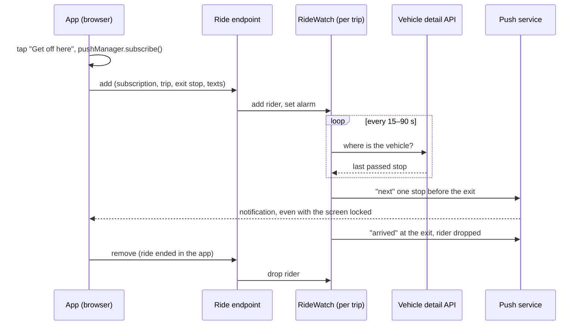

# Ride notifications

Ride mode ("Alert me before my stop") tells the rider to get off one stop before their exit, and again on arrival. While the app is open it does this itself. With the screen locked the app is suspended, so the alerts come as **Web Push** from the server. This page explains how that works; [Ride push deployment](./ride-push-deployment.md) covers setting it up.

## The pieces

| Piece | Where | Role |
| ----- | ----- | ---- |
| Subscribe and register | `src/lib/push.ts`, called from `StopTimeline.tsx` | Subscribes the browser to push on the tap that picks the exit stop, then registers the ride with the API |
| Unregister | `src/hooks/features/useRidePush.ts` | When the ride ends or is replaced, tells the API and clears the ride's notifications |
| Endpoint | `functions/api/[city]/ride.ts` | Validates the request (`functions/_core/rideSchemas.ts`) and forwards it to the trip's Durable Object |
| `RideWatch` Durable Object | `functions/_workers/RideWatch.ts`, in the separate `departs-ride-push` Worker | Holds the trip's riders, wakes on an alarm, reads the vehicle's position, sends the pushes |
| Alert rule | `functions/_domain/rides/rideAlert.ts` | Decides `next` (the vehicle left the stop before the exit) or `arrived` |
| Push sender | `functions/_core/push/webPush.ts` | VAPID signing (RFC 8292) and payload encryption (RFC 8291), WebCrypto only |
| Service worker | `public/push-sw.js`, imported into the app's service worker | Shows the notification in browsers without Declarative Web Push; opens the ride on a tap |

## Flow



1. **Subscribe.** Picking the exit stop calls `pushManager.subscribe()` directly from the tap. iOS asks for notification permission only during a user gesture, so the subscription comes first. Where push isn't available (iOS outside the installed app, old browsers) the app falls back to its local alerts. Any other failure shows a toast saying alerts only come while the app is open.
2. **Register.** The app sends the subscription, the trip, the exit stop's sequence, the ride's page path and the alert texts, already translated into the user's language.
3. **Watch.** One Durable Object per trip and vehicle holds every rider on it. Its alarm reads the trip's live detail from our own `/api`, the same data the app shows. It wakes every 15 s while any rider is within two stops of their exit, and every 90 s otherwise.
4. **Push.** `next` goes once the vehicle has passed the stop before the exit. `arrived` goes at the exit or the trip's last stop, even if `next` was missed. Each alert goes once per rider. After `arrived` the rider is dropped.
5. **End.** Ending or replacing the ride in the app removes the rider. A removal only drops the rider if its exit still matches, so ending an old ride can't remove the new one. With no riders left the Durable Object deletes its storage and stops waking.

The vehicle's position is the feed's last passed stop, so every city works the same way, including Brno, whose server-side feed reports positions without delays. A trip with no live position yet (not started, or timetable-only) is watched without alerting until the vehicle shows up.

## Message format

Pushes use **Declarative Web Push** (`web_push: 8030`). Safari on iOS and macOS 18.4+ shows these without running the service worker, which makes them more reliable. Other browsers hand the same JSON to `push-sw.js`, which shows it the same way.

```json
{
  "web_push": 8030,
  "notification": {
    "title": "Get off at the next stop",
    "body": "Trutnovská",
    "navigate": "https://departs.app/prague/trip/58_1865_250714/service-0-8518",
    "tag": "ride-own",
    "requireInteraction": true,
    "renotify": true,
    "vibrate": [300, 150, 300, 150, 600]
  }
}
```

- **`navigate`**: the ride's page, on the origin the rider registered from. Tapping the notification opens it.
- **`tag`**: `arrived` replaces `next`, so no stale alert stays in the notification centre.
- **`requireInteraction`, `renotify`, `vibrate`**: Android and desktop Chrome honour them (`RIDE_PUSH.ALERT_OPTIONS`); iOS ignores them. On Android the service worker also sets the monochrome status-bar badge `public/notification-badge.png`.

On iOS a notification shows its title, body and app icon, and sound, vibration and Focus follow the user's notification settings for the app.

While the app is open the push still arrives as a system notification, and the app adds only a toast and a vibration (`Ride.pushed`).

## Limits and safeguards

All tunables live in `RIDE_PUSH` in `functions/_core/config.ts`.

| Safeguard | Value |
| --------- | ----- |
| Push endpoint must be `https` on a known push service | `PUSH_SERVICE_HOSTS` |
| Subscription keys must be a P-256 point and a 16-byte secret | `rideSchemas.ts` |
| Request body | 8 KB |
| Riders per trip | 50 |
| Detail reads per trip | at most one per 15 s, however many riders register |
| Rider lifetime | 4 h |
| Trip that never answered (made-up id) | given up after 2 failed reads |
| Trip that stops answering | given up after 20 failed reads (~10 min) |
| Vehicle without a live position after it had one | given up after 10 min |
| One broken subscription | dropped on its own; the trip's other riders still get their pushes |
| Subscription the push service no longer knows (404, 410) | dropped |

On top of these, the zone's rate limit covers `/api/*` ([Production deployment, step 7](./deployment.md#rate-limiting-security--security-rules)).

## Privacy

The server stores, per rider, the push endpoint and its keys, the trip, the exit stop and the alert texts, for at most the length of the ride (4 h). Logs carry the trip id and the push status, never the endpoint. Pushes are encrypted for the device, so the push service only delivers them. The privacy policy (`legal.privacy` in the locale files) describes this. Update it if what is stored changes.

## Costs on the free plan

- **Durable Objects**: their own 100,000 requests a day. A ride takes roughly 15–20 alarms.
- **Workers and Pages Functions**: one shared 100,000 requests a day. Each alarm reads `/api/<city>/vehicle-detail` once, so a ride costs about as many API requests as alarms.
- **CPU**: an alarm takes 1–2 ms, the detail read 3–8 ms, both well under the 10 ms limit.

## Debugging

- `npx wrangler tail departs-ride-push` streams alarms and their `{"push": …, "status": …}` lines. Status `201` means the push service accepted the push.
- `npx wrangler pages deployment tail --project-name departs-app` streams the `/api/<city>/ride` requests.
- To run it locally, see [Local development](./local-development.md#ride-push-locally).
